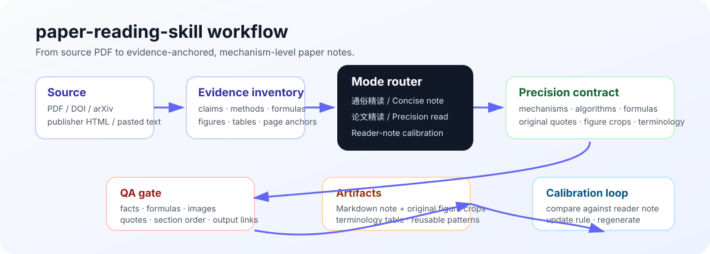

<div align="center">

# 📚 paper-reading-skill


**把论文读成可核查、可复用、可继续写作的精读工程。**  
不是一个泛泛 summarizer，而是一套从 PDF 到证据锚定、机制拆解、原图裁剪、术语表和用户笔记校准的 Codex skill。

[快速开始](#-安装与使用) · [核心创新](#-核心创新) · [精读契约](#-论文精读契约) · [目录结构](#-仓库结构)

</div>

---

## ✨ 它解决什么问题

普通论文总结经常变成这样：

```text
本文提出了一个方法。
实验结果很好。
有一定局限性。
```

这类笔记省略了最关键的东西：机制为什么成立、约束是什么、公式怎么读、图放在哪里、原文依据在哪里、术语第一次出现时怎么解释。

`paper-reading-skill` 把论文阅读变成一条稳定的工程流水线：

```text
PDF / DOI / arXiv / HTML / pasted text
        ↓
证据清单：claim、机制、公式、图表、页码
        ↓
路由到通俗精读 或 Precision Deep Read
        ↓
机制拆解 + 原文引用 + 原图裁剪 + 术语表
        ↓
QA gate 检查事实、公式、图、节号和链接
        ↓
Markdown 精读稿 + assets + 可复用写作模式
```



---

## 🚀 核心创新

### 1. 两种模式，一个 skill

| 模式 | 什么时候用 | 产出风格 |
|---|---|---|
| **通俗精读 / Concise** | 想快速理解论文的问题、方法、实验和边界 | 短因果主线：为什么值得读 → 问题 → 方法 → 实验 → 价值与边界 |
| **Precision Deep Read / 论文精读** | 需要逐机制、逐算法、逐图表、逐原文句的精读稿 | 保留论文节号、术语表、机制颗粒度、关键原文和原图裁剪 |
| **Reader-note calibration** | 你已有自己的最终版笔记，要求 AI 对齐你的读法 | 对比 claim selection、颗粒度、术语、原文位置、插图位置，然后更新规则并重生成 |

---

### 2. Evidence-first：所有关键判断都能回到论文

skill 会要求：

- 每个关键数字附带实验条件、baseline、指标和范围；
- 每张使用的图都视觉核验，并保留 Figure/Table/Algorithm 编号与 PDF 页码；
- 每个承重结论绑定原文句或图表证据；
- 作者主张、论文证据、读者判断分开；
- 无法核验的内容明确标为材料不足，而不是脑补。

这避免精读稿变成“看起来合理但找不到出处”的二次创作。

---

### 3. Precision Deep Read：机制级粒度，不是目录复述

论文精读模式会强制回答：

```text
为什么这个组件存在？
输入和输出是什么？
关键约束是什么？
公式在优化什么？
算法里的黑盒函数做了什么？
结果交给下一个模块时是什么形态？
```

例如算法不只写成“枚举配置后选择最优”，而是拆成：

| 检查项 | 要求 |
|---|---|
| Objective | 明确最小化/最大化什么，单位是什么 |
| Search space | 枚举哪些变量：instance size、TP、placement、allocation 等 |
| Feasibility | 显存、拓扑、矩形形状、容量、队列顺序等约束 |
| Black-box helper | 如 `test()`、`simu()` 的定位、返回值和论文未说明处 |
| Microexample | 保留 `(8α+16)=4×(2+2+2α)` 这类物理分解 |
| Interface | 输出交给哪个 scheduler / evaluator |

> 如果论文没有说清某个实现细节，skill 会用 `精读追问` 标注，而不是悄悄编造。

---

### 4. 术语先讲清，机制才读得懂

系统论文经常一上来就是：

```text
phase、instance、QP/QD、FCFS、chunked prefill、continuous batching、goodput、D2D、W2W、GQA、All-Gather、All-Reduce
```

Precision mode 会在正文前生成 **术语与符号表**，并区分容易混淆的概念：

- `phase` 是处理阶段；`instance` 是承载该阶段的硬件资源组；
- `QP` 是 prefill queue；`QD` 是 decoding queue；
- `D2D` 是 wafer 内 die-to-die；`W2W` 是 wafer-to-wafer；
- GEMM 里的 `K` 不是 Attention 里的 Key；
- `idle` 是资源空闲，`stall` 更强调任务因等待而暂停。

---

### 5. Reader-note calibration：对齐你的读法，而不是强行复述目录

如果你提供自己的最终版笔记，skill 会做小节级对比：

- 同样的机制有没有选中？
- 颗粒度是否一致？
- 关键原文句放在哪些判断下面？
- 图表是否插在同一决策点？
- 术语是否一致？
- 是否遗漏了你关心的约束、公式、数值例或开放问题？

然后更新精读规则，并重新生成稿件。  
这就是从“AI 总结”变成“可校准的个人阅读系统”的关键。

---

## 🧭 两种产出风格

### A. 通俗精读

适合快速理解一篇新论文：

```text
为什么值得读
→ 原来有什么问题
→ 方法怎样一步步解决
→ 实验说明什么
→ 价值与边界
```

输出短因果链、核心图、关键结果和边界条件。

### B. Precision Deep Read

适合组会、复现、写 related work 或准备自己的论文。

会生成：

```text
论文标题
→ 来源范围
→ 全文逻辑总览
→ 术语与符号表
→ 按论文节号的机制精读
→ 关键原文句
→ 原图裁剪
→ 实验 / DSE / ablation / placement
→ 可复用图表配置表
→ 高频句式模板
```

---

## 🧪 典型请求

```text
$paper-reading 把这篇 PDF 精读一下，保留论文节号、关键原图和原文句。
```

```text
$paper-reading 这是我的最终版精读笔记。对比你生成的版本，找出差距，更新 skill 后重写。
```

```text
$paper-reading 不要泛泛总结，把 Algorithm 1/2、公式、约束和 test/simu 这类黑盒函数讲清楚。
```

```text
$paper-reading 给这篇系统论文加术语表，解释 phase/instance、QP/QD、FCFS、chunked prefill 和 continuous batching。
```

---

## 📥 你需要提供

最少只需要一个来源：

```text
PDF
DOI
arXiv link
publisher HTML
pasted text
```

如果想要更贴近你的风格，还可以给：

- 你自己的最终版精读笔记；
- 关注的论文小节；
- 目标输出目录；
- 是否需要裁剪原图；
- 是否需要术语表和高频句式模板；
- 是否用于组会、复现、related work 或论文写作。

---

## 📦 你会得到

| 产物 | 说明 |
|---|---|
| `*.md` | 论文精读 / 深入评述笔记 |
| `assets/` | 从 PDF 裁剪的 Figure / Table / Algorithm 图片 |
| 术语表 | 在正文前统一解释关键概念 |
| 原文锚点 | 关键英文原句 + section / figure / page locator |
| 机制拆解 | 方法、公式、算法、黑盒函数和接口 |
| 可复用图表配置表 | 每张图的作用与复用方式 |
| 高频句式模板 | 提炼论文中可复用的写作句式 |
| QA 结果 | 事实、公式、图片、节号、链接检查 |

---

## 🛠 安装与使用

### 安装

```bash
git clone https://github.com/xy-lo/paper-reading-skill.git ~/.codex/skills/paper-reading
```

重启 Codex，或在任务中显式调用：

```text
$paper-reading
```

### 推荐开场提示

```text
Use $paper-reading 对这篇 PDF 做 Precision Deep Read。
要求：
1. 保留论文节号；
2. 开头加术语与符号表；
3. 方法/算法/公式按机制拆解；
4. 插入裁剪后的原图；
5. 关键英文原句用橙斜体；
6. 最后给可复用图表配置表和高频句式模板。
```

---

## 🗂 仓库结构

```text
paper-reading-skill/
├── README.md
├── SKILL.md
├── agents/
│   └── openai.yaml
├── docs/
│   └── assets/
│       └── workflow.svg
└── references/
    ├── report-template.md
    ├── precision-reading-style.md
    ├── figure-and-evidence-rules.md
    └── reference-style.md
```

| 文件 | 作用 |
|---|---|
| `SKILL.md` | skill 入口、模式路由和整体工作流 |
| `references/report-template.md` | 通俗精读与深入评述模板 |
| `references/precision-reading-style.md` | 论文精读契约、算法/公式/术语颗粒度、用户笔记校准 |
| `references/figure-and-evidence-rules.md` | 图表选择、视觉核验、证据锚点 |
| `references/reference-style.md` | 稳定的写作风格来源与适用边界 |
| `docs/assets/workflow.svg` | README 工作流图 |

---

## ✅ QA gate

交付前会检查：

- 论文节号和顺序是否一致；
- 数字、公式、算法约束、组件名是否与 PDF 一致；
- 原文引用是否真实存在且没有改写 claim；
- 每张图是否被视觉核验、裁剪是否完整；
- 算法是否有输入/决策/输出或黑盒函数说明；
- 术语是否在首次使用处或术语表中解释；
- 相对图片链接是否有效；
- 用户参考笔记是否导致无证据改写。

---

## 🚧 边界

- 不做全文逐句双语翻译；这类任务应交给 `nature-reader`。
- 不自动生成正式 PPT；这类任务应交给 `nature-paper2ppt`。
- 不模拟正式审稿报告；这类任务应交给 `nature-reviewer`。
- 无法合法获取全文时，只基于可用摘要/元数据保守输出，并明确来源范围。
- 图像不可读、PDF 扫描质量差或图表无法裁剪时，会说明证据限制，不会假装已经看图。

---

## 🔭 设计方向

当前已经支持：

- PDF / DOI / arXiv / HTML / pasted text；
- 通俗精读与论文精读；
- 用户笔记校准；
- 系统论文术语表；
- 算法、公式、黑盒函数和微示例规则。

后续适合继续加强：

- 自动维护个人阅读风格 profile；
- 多论文横向比较模板；
- related work evidence matrix；
- 复现实验 checklist；
- 与写作 / PPT / reviewer skills 的更紧密流水线。

---

## 📄 License

查看仓库许可证文件。论文原图版权归原出版方，使用时请遵守来源论文和出版方许可。
