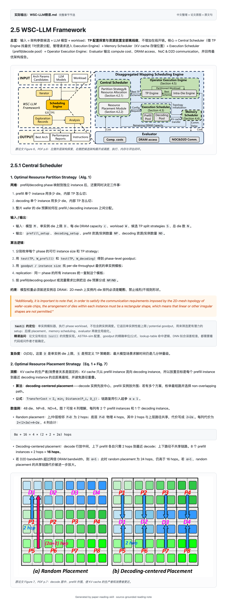

# paper-reading-skill

读论文时，只拿到一段“本文提出了什么方法、实验效果很好”的摘要，通常不够。真正有用的笔记要能回答：这一节为什么存在？图在讲什么？核心创新到底新在哪？哪些原文句子和图表之后写作还能用？

这个 skill 就是把一次论文阅读整理成这种能回看、能引用、能积累的材料。

---

## 它会帮你做四件事

### 1. 跟原文章节对应，梳理整体逻辑

笔记不会凭空重排成“背景 / 方法 / 实验”的万能模板，而是保留论文自己的章节关系。  
比如一篇系统论文会按原来的 `2.5.1 Central Scheduler`、`2.5.2 Execution Scheduler` 展开，同时先说明这一章在整个框架里的位置：输入是什么、哪些模块联动、结果交给谁。

关键英文原句也会摘出来，用橙色斜体标出。这样能分清：

- 哪些是论文原话；
- 哪些是我的中文整理；
- 哪些是还没被论文说清楚的实现细节。

### 2. 图文对应，把每张图讲清楚

论文里的 Figure / Table / Algorithm 不会堆在文末，而是放在解释它的位置附近。

比如 WSC-LLM 的 Central Scheduler 一节，会先拆解 resource partition 和 placement 的决策逻辑，再放 Figure 6 / Figure 7。读的时候可以直接对照：

- 架构图里的模块怎么联动；
- placement 图里哪条路径更短；
- 公式里的 hop 数为什么这么算；
- caption 对应 PDF 哪一页。

这样图不是装饰，而是帮助理解机制。

### 3. 总结核心创新，只保留关键逻辑

论文里有很多工程细节，但笔记会优先保留支撑核心创新的内容：

- 关键约束；
- 设计动机；
- 算法输入输出；
- 优化目标；
- 和 baseline 的差异；
- 实验里真正支撑结论的数字。

像“作者回顾了相关工作”这种内容会被压缩；像“为什么 D2D bandwidth 大于 DRAM bandwidth 时可以全 wafer DRAM 做 KV cache 池”这种机制会保留。

如果论文没有说清某个实现细节，例如某个算法调用了 `test()` 但没说明内部实现，笔记会用 `精读追问` 标出来，而不是替作者编一个解释。

### 4. 整理可复用图表和写作句子

每篇精读稿后面会有两部分：

**可复用图表配置表**  
记录每张图的作用，以及写论文时可以怎么复用它的表达方式。  
例如：总体框架图、motivation 实验图、机制对比图、end-to-end 性能图、ablation 图分别适合放在哪类论文里。

**高频句式模板**  
摘出论文里组织 claim、动机、公平比较、机制归因、结论的英文句式。  
之后写 related work、method motivation 或 evaluation discussion 时，可以直接回看这些句子结构。

这就是“边读边积累”：读一篇文章，同时攒下后面写作需要的证据和表达。

---

## 实际效果

下面是 WSC-LLM 精读稿中 `2.5.1 Central Scheduler` 的节选。  
里面有中文整理、论文 Figure 6 / Figure 7、橙色原文句，以及公式和数值例的解释。



---

## 颜色和格式的作用

- **普通中文**：我的整理和解释；
- **橙色斜体**：论文原文句子；
- **表格**：配置对比、实验结果、架构候选；
- **`精读追问`**：论文没说清、需要看代码或问作者的问题；
- **Figure/Table/Algorithm 编号**：保持和原文一致，方便回查。

---

## 输入

可以用下面任意一种来源：

```text
PDF
DOI
arXiv link
publisher HTML
pasted text
```

如果你希望输出更贴近自己的阅读习惯，也可以把你已有的精读笔记一起给出来。skill 会对比两者的小节、机制、术语、原文句位置和插图位置，再决定要不要调整规则后重新生成。

---

## 使用例子

```text
把这篇 PDF 精读一下。
保留原文章节号、关键英文原句和论文原图。
公式和算法要拆到能看懂的程度。
```

```text
这是我自己的最终版笔记。
对比你生成的版本，找出差距，更新 skill 后重写。
```

```text
这篇系统论文里的 Algorithm 1、test()、公式和约束都解释清楚。
不要只说“枚举配置然后选择最优”。
```

---

## 输出形态

这个 skill 不是只有一种固定模板，也不是简单分成两种风格。

`SKILL.md` 里实际定义了几类深度：

| 类型 | 什么时候用 |
|---|---|
| 默认通俗精读笔记 | 想快速理解论文的问题、方法和结果 |
| 论文精读 / Precision Deep Read | 需要按原文章节、机制、原图和原文句做完整笔记 |
| 深入评述 | 需要分析证据链、限制、可复现性或批判性问题 |
| 短问题回答 | 只问某个概念或机制，不需要生成长文 |
| 多论文对比 | 分别整理多篇文章，再给出比较和综合 |

所以，如果你明确说“论文精读”，就会进入上面展示的完整精读形态；如果只是问一个概念，就不会强行生成一篇长笔记。

---

## 安装

```bash
git clone https://github.com/xy-lo/paper-reading-skill.git ~/.codex/skills/paper-reading
```

然后在 Codex 里通过：

```text
$paper-reading
```

调用。

---

## 仓库结构

```text
paper-reading-skill/
├── README.md
├── SKILL.md
├── agents/
│   └── openai.yaml
├── docs/
│   └── assets/
│       └── wsc-llm-central-scheduler.png
└── references/
    ├── report-template.md
    ├── precision-reading-style.md
    ├── figure-and-evidence-rules.md
    └── reference-style.md
```

---

## 边界

这个 skill 不会：

- 把论文逐句翻译成双语全文；
- 把内容改写成无法回溯来源的泛泛介绍；
- 在图片没有核验时假装已经看过图；
- 在论文没有说明实现细节时替作者补结论；
- 自动生成正式 PPT 或审稿报告。

如果任务是全文双语翻译、正式审稿或 PPT 制作，应该交给对应的专门 skill。
